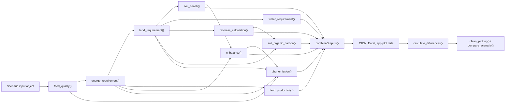

# cleaned

`cleaned` implements the iCLEANED model: inclusive Comprehensive Livestock Environmental Assessment for Improved Nutrition, a Secured Environment, and Sustainable Development along livestock and fish value chains.

The package estimates environmental indicators for livestock production systems from a structured scenario input object. The iCLEANED Shiny app builds scenarios, passes them into the package, and uses compact app-facing outputs for result tables and interactive plots. The package contains only what the app uses.

## What the Package Calculates

The core model pipeline links feed, livestock, soil, water, and greenhouse gas modules:



The main indicators include:

- Feed quality and feed allocation by livestock class and season.
- Energy, protein, dry matter intake, manure, and livestock productivity.
- Land and dry matter requirements for on-farm feeds, off-farm roughages, off-farm concentrates, and imported concentrates.
- Soil erosion, nitrogen balance, biomass carbon change, and soil organic carbon change.
- Water use by feed item and product.
- Greenhouse gas emissions from enteric fermentation, manure, soils, fertilizer, burning, rice, and off-farm feed production.
- Scenario comparison indicators for GHG emissions, land, nitrogen balance, erosion, water, carbon stock change, and food/protein output.

## Installation

Install from a local checkout:

```r
install.packages("remotes")
remotes::install_local("path/to/cleaned")
```

Or install from a tagged GitHub release:

```r
remotes::install_github("CIAT/cleaned@v0.7.0")
```

For development on Windows, verify the package with:

```powershell
R CMD INSTALL .
Rscript -e "library(cleaned); packageVersion('cleaned')"
```

## Runtime Requirements

The package requires R >= 4.0.0 and imports:

- `jsonlite`
- `data.table`
- `tidyr`
- `dplyr`
- `tibble`
- `utils`
- `stringr`
- `openxlsx`

The iCLEANED app has additional dependencies outside this package. In particular, interactive plotting uses `ggiraph`; when the app uses `ggplot2 4.x`, use `ggiraph 0.9.6` or newer.

## Input Object

Most exported functions use a nested scenario object named `para`. It can be built from JSON or from the app's scenario builder. At minimum, a full model run expects these sections:

- `livestock`: livestock category, herd composition, weight, growth, milk, manure management and nutrient fields, plus the classification fields below.
- `seasons`: season names and lengths.
- `feed_items`: feed nutrient composition, crop/feed production parameters, fertilizer application, water coefficients, erosion parameters, and biomass/SOC fields.
- `feed_basket`: feed allocations by season and livestock category.
- `fertilizer`: fertilizer descriptions and nitrogen content. Empty fertilizer data are accepted by some modules.
- Farm, climate, soil, land-use, manure import, and product waste scalar fields.
- External parameter lists: energy parameters, GHG/IPCC parameters, and stock change parameters.

For feed nutrient composition, the minimum fields needed by `feed_quality()` are:

- `dm_content`: dry matter content, percent of fresh matter.
- `me_content`: metabolizable energy using the package's feed database basis.
- `cp_content`: crude protein, percent of dry matter.

The full pipeline needs additional agronomic and spatial fields because land, nitrogen, water, soil, and biomass modules depend on crop yield, residue, slope, soil, evapotranspiration, precipitation, fertilizer, and tree parameters.

### Livestock classification

Equations are chosen from these fields, not from the livestock name, so livestock types can be added or renamed freely:

| Field | Allowed values | Used for |
|---|---|---|
| `species` | Cattle, Buffalo, Sheep, Goats, Pigs | Energy and nitrogen equations, species totals |
| `animal_class` | Cattle/Buffalo: Cows, Adult males, Young stock; Sheep: Ewes, Breeding rams, Fattening rams, Lambs; Goats: Does, Breeding bucks, Fattening bucks, Kids; Pigs: Lactating/pregnant sows, Dry sows/boars, Growers | Energy and nitrogen equations |
| `ipcc_ef_category_t2` | Dairy cows, Non-dairy, Sheep, Goats, N/A | Enteric methane Ym (IPCC Tables 10.12, 10.13) |
| `ipcc_manure_ch4_category` | Dairy cattle, Other cattle, Buffalo, Sheep, Goats, Swine | Manure methane Bo (IPCC Table 10.16) |
| `ipcc_n_loss_category` | Dairy Cow, Other Cattle, Swine, Poultry, Other animals | Manure N losses (IPCC Table 10.22) |
| `ipcc_prp_category` | Cattle, pigs and poultry; Sheep and other animals | Pasture N2O factor EF3PRP (IPCC Table 11.1) |

Study objects without these fields still run: the fields are filled from the names of the 23 standard iCLEANED livestock types (see `?resolve_livestock_categories`). See [Input Contract](vignettes/input-contract.Rmd) for the full field reference and unit notes.

## Standard Model Run

```r
library(cleaned)
library(jsonlite)

para <- fromJSON("scenario_input.json")
energy_parameters <- fromJSON(system.file("extdata", "energy_parameters.json", package = "cleaned"))
ghg_parameters <- fromJSON(system.file("extdata", "ghg_parameters.json", package = "cleaned"))
stock_change_parameters <- fromJSON(system.file("extdata", "stock_change_parameters.json", package = "cleaned"))

feed_basket_quality <- feed_quality(para)
energy_required <- energy_requirement(para, feed_basket_quality, energy_parameters)
land_required <- land_requirement(feed_basket_quality, energy_required, para)
soil_erosion <- soil_health(para, land_required)
nitrogen_balance <- n_balance(para, land_required, energy_required, soil_erosion)
water_required <- water_requirement(para, land_required)
livestock_productivity <- land_productivity(para, energy_required)
biomass <- biomass_calculation(para, land_required)
soil_carbon <- soil_organic_carbon(para, stock_change_parameters, land_required, biomass)
ghg_emissions <- ghg_emission(
  para,
  energy_required,
  ghg_parameters,
  land_required,
  nitrogen_balance,
  feed_basket_quality
)

outputs <- combineOutputs(
  para,
  feed_basket_quality,
  energy_required,
  land_required,
  soil_erosion,
  water_required,
  nitrogen_balance,
  livestock_productivity,
  biomass,
  soil_carbon,
  ghg_emissions,
  filePath = "scenario_output.json"
)
```

## Output Structure

`combineOutputs()` writes an Excel workbook and returns a list that supports both app and batch workflows.

App-facing outputs:

- `json_output`
- `on_farm_table`
- `nitrogen_balance`
- `land_required`
- `water_use_per_feed_item`

Batch-facing outputs:

- Detailed land, dry matter, soil, nitrogen, water, livestock productivity, manure, biomass, soil carbon, product waste, and GHG tables.
- Full Excel sheets for intermediate results and diagnostics.

## Scenario Comparison

The app's comparison screen runs three steps on the scenario output JSON files written by `combineOutputs()`:

1. `calculate_differences(comparison_file, scenario_1.json, scenario_2.json, ...)` reads the scenario outputs and writes one comparison JSON (one row of scalar indicators per scenario) plus `runs_comparison.xlsx`.
2. `clean_plotting(comparison_file, output_dir)` prepares the plot data with no base scenario.
3. `compare_scenario(base_scenario, comparison_file, output_dir)` prepares the plot data as percentage differences from a chosen base scenario.

## Batch Processing

Many farms can be collected in the field with ODK or KoboToolbox (or described
in an Excel template) and run in one go. The batch file holds farm-level data only; anything left blank comes
from the parameter database (`lkp_defaults`, `lkp_feeditem_defaults`,
`lkp_crops_defaults` and the lookup tables).

```r
db <- "path/to/parameters_database/Ethiopia - Small Ruminants"

write_batch_template(db, "batch_template.xlsx")        # 1. empty template + dictionary
report <- validate_batch_input("my_farms.xlsx", db)    # 2. check before running
res <- run_batch("my_farms.xlsx", "batch_output",      # 3. one study object and result per farm,
                 parameter_database = db)              #    summary and group averages
compare_batches(baseline$summary, res$summary)         # 4. farm-by-farm differences

# One parameter database for batch processing: the long list of the livestock
# types, feeds and crops of all regional databases (most common value kept
# where they differ; review_conflicts.csv lists the differences)
build_batch_database(regional_database_folders, "Long list - all regions", defaults_from = "Ethiopia - Small Ruminants")

# Field data collection with ODK: farmer-framed questions; feeds and unusual
# manure practices in the farmer's own words, matched to the database
write_odk_form(db, "farm_survey.xlsx", groups = "site")   # XLSForm for ODK Central / Kobo
odk <- read_odk_export("odk_central_export.zip", "farm_survey.xlsx", db)
odk$to_match                                            # suggestions to confirm
odk <- read_odk_export("odk_central_export.zip", "farm_survey.xlsx", db, matches = odk$to_match)
remember_answer_matches(odk$to_match, db)               # matched automatically next time
# Feeds bought are counted off the farm through copies tagged OFR / OFC / IP
if (!is.null(odk$variants)) {
  add_feed_variants(odk$variants, db)
  odk <- read_odk_export("odk_central_export.zip", "farm_survey.xlsx", db, matches = odk$to_match)
}
odk$bought                                              # amounts bought vs. what the diets suggest
write_batch_file(odk$input, db, "my_farms.xlsx")
```

`build_study_objects()` and `run_study_object()` give access to the
intermediate steps. In iCLEANED the same steps are available on the Batch page
(enabled with the environment variable `ICLEANED_BATCH=true`).

## Documentation

The documentation set is organized as:

- [Model Overview](vignettes/cleaned-overview.Rmd)
- [Input Contract](vignettes/input-contract.Rmd)
- [Output Contract](vignettes/output-contract.Rmd)
- [Developer Guide](vignettes/developer-guide.Rmd)

The documentation website is built from these files with `pkgdown::build_site()` (configuration in `_pkgdown.yml`, output in `docs/`).

Function-level help is available in R:

```r
?feed_quality
?combineOutputs
?calculate_differences
?resolve_livestock_categories
```

## Development Checks

Before pushing calculation or output changes:

```powershell
Rscript -e "for (f in list.files('R', pattern='\\.R$', full.names=TRUE)) parse(file=f)"
R CMD INSTALL .
```

Recommended full package check:

```powershell
R CMD check --no-manual .
```

For app compatibility, install the local package into the app test library and confirm:

```r
library(cleaned)
find.package("cleaned")
packageVersion("cleaned")
```

The path should point to the intended local or released package version.

## Repository Layout

```text
R/                 exported model functions and helpers
man/               generated function documentation
vignettes/         user and developer documentation
docs/              documentation website (pkgdown)
inst/extdata/      model parameter JSON files read by the app, and
                   example_input.json (example study object, Rungwe)
auxilary_info/     reference workbooks: output data dictionary (ReadMe.xlsx) and
                   literature benchmarks (CLEANED_benchmark_RGQ.xlsx, also
                   shipped in the app's www/ReadMe.xlsx)
```

## Citation

Use the package citation metadata in `CITATION.cff` when citing the software.
